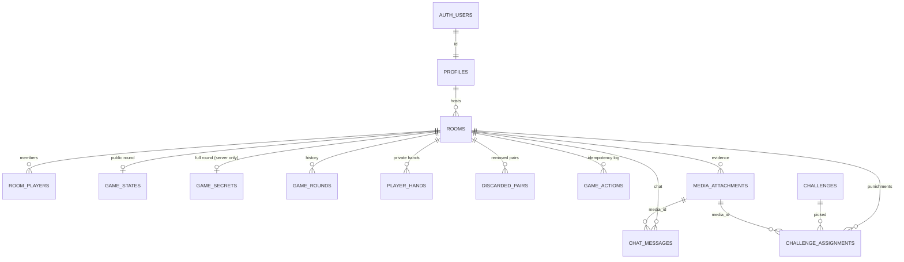
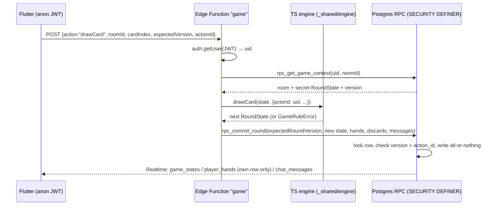

# DATABASE_SCHEMA — الشايب أونلاين (PostgreSQL / Supabase)

## Tables

| Table | Purpose | Client access (RLS) |
|---|---|---|
| `profiles` | nickname, avatar, lifetime stats | read own (`profiles_select_own`); insert/update **ONLY `(nickname, avatar_id)`** (column-level grants); lifetime stat columns are server-written only |
| `rooms` | settings, status, round/match counters, 6-char code | read if member; **no writes** |
| `room_players` | seat (unique per room), ready, score, losses, title | read if member; **no writes** |
| `game_states` | public round JSON (counts, turn, target, finish order — **no card ids**) | read if member |
| `game_secrets` | complete engine `RoundState` (all hands) | **no policy → invisible** |
| `game_rounds` | one row per round: order, finish order, loser, points | read if member |
| `player_hands` | one row per player per room, `cards jsonb` | **only `user_id = auth.uid()`** |
| `discarded_pairs` | pairs removed each turn | members, **only after the round is finished** |
| `game_actions` | `(room_id, action_id)` unique → idempotent retries | read own |
| `chat_messages` | user / system / reaction / evidence messages | read if member; **no writes** |
| `chat_rate` | per-user last-sent timestamp (anti-spam) | none |
| `challenges` | 30 seeded challenges | read enabled |
| `challenge_assignments` | loser ↔ challenge, status, redraws (≤2), proof | read if member |
| `media_attachments` | Storage path, MIME, size, duration, 7-day expiry | read if member & not deleted |

Views: `public_rooms` (public waiting rooms, **no code, no member list**) and `leaderboard` (top-100 ranked players). Both views run with `security_invoker = false` so `authenticated` clients can view public directory rows and top-100 stats despite `rooms` and `profiles` RLS.

## Key constraints

- Nickname 2–24 chars, no `<>`, reserved names (`النظام`, `system`, `admin` …) rejected — both CHECK and RPC.
- `max_players 2–6`, `total_rounds 1–20`, `turn_timer_seconds 15–120`, room code `^[A-Z0-9]{4,8}$` unique.
- `unique(room_id, seat)`, `unique(room_id, round_id)`, `unique(room_id, match_number, round_number)`.
- `discarded_pairs.cards` must be a JSON array of exactly 2 cards.
- `challenge_assignments.redraw_count between 0 and 2`; media voice ≤ 30 s, image ≤ 2 MB, voice ≤ 1 MB.

## Write path (server-authoritative)

- All RPCs: `revoke … from public, anon, authenticated; grant execute … to service_role`.
- Stale versions raise `stale_version`; repeated `action_id` returns `alreadyApplied: true`.
- Any exception rolls back the whole transaction.

## Realtime publication

`rooms, room_players, game_states, game_rounds, player_hands, chat_messages, challenge_assignments`.
Realtime respects RLS, so a client only ever receives its **own** `player_hands` row.
`game_secrets`, `game_actions`, `chat_rate` are deliberately **not** published.

## Storage

Bucket `shayeb-media` (private). Path `roomId/uid/uuid.ext` (UUID filename enforced in SQL Migration 7). Uploads use a signed upload URL issued
by the `media` function after checking membership, room openness, MIME, size (≤ 2 MB image / ≤ 1 MB voice), and voice duration (≤ 30 s); `rpc_attach_media` re-verifies the object exists
in `storage.objects` with matching MIME and allowed size before recording it, and sets `expires_at` to at least 7 days past room expiration (closing a room no longer expires media early). Downloads use 60-second signed URLs requested on demand by durable `mediaId`.
Scheduled cleanup (`action: "cleanupExpired"`) requires the `x-cron-secret` header matching the `CLEANUP_CRON_SECRET` Edge Function secret, and only sets `deleted_at` after Storage deletion succeeds.

In Migration 7, `rpc_assign_challenge` enforces `challenge_mode` (`disabled` / `end_of_match` / `every_round`), and `rpc_challenge_action` restricts actions strictly to `loser_id` (the host cannot override).
